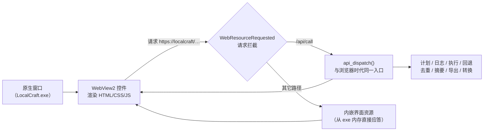

# LocalCraft

> **完全离线的本地文件处理工具** · 纯 C 实现 · 不联网 · 不上传 · 不使用任何 AI 模型

**批量重命名 / 整理分类 / 格式转换 / 内容去重 / 文档摘要 / 导出 Markdown·Word·PDF**

核心承诺只有一条：

> ### 任何批量操作都遵循「先预览 → 再执行 → 可随时回退」

预览阶段完全只读，把每个文件的「旧状态 → 新状态」列成对照表；你确认后才真正落地；
执行过程逐步写入回退日志 —— 执行到第 7 步断电，前 6 步依然能完整还原，且回退本身也可再回退。


---

## 目录

- [下载与运行](#下载与运行)
- [关于「Windows 已保护你的电脑」](#关于windows-已保护你的电脑)
- [六个模块](#六个模块)
- [能力边界（不夸大）](#能力边界不夸大)
- [可回退机制是怎么做的](#可回退机制是怎么做的)
- [界面是怎么做的](#界面是怎么做的)
- [从源码构建](#从源码构建)
- [测试数据](#测试数据)
- [项目结构](#项目结构)
- [为什么用 C](#为什么用-c)
- [许可](#许可)

---

## 下载与运行

到 [Releases](../../releases) 下载 `LocalCraft.zip`，解压后双击 **`LocalCraft.exe`**。

```
LocalCraft/
├── LocalCraft.exe          ← 双击这个
├── WebView2Loader.dll      ← 必须和 exe 放在一起，别单独拖走 exe
├── 解除锁定.bat            ← 如果弹安全提示，双击这个（见下一节）
└── 使用说明.txt
```

**不需要安装任何运行库。** 程序是静态链接的，目标电脑不需要 Python、.NET、VC++ 运行库。

界面由系统自带的 **Microsoft Edge WebView2 Runtime** 渲染（Windows 10/11 基本都自带）。
万一那台电脑没有，程序会**自动退回纯 Windows 控件界面**并说明原因，功能一样，不会白屏。

**U 盘便携**：在 exe 同目录放一个空的 `portable.marker` 文件，
日志、回收站、界面配置就都写在 exe 旁边的 `.localcraft\` 里，不碰系统盘。

命令行参数：

| 参数 | 用途 |
|------|------|
| （无） | 正常启动图形界面 |
| `--native` | 用纯 Win32 控件界面（不依赖 WebView2） |
| `--headless --port 8080` | 只启动本地服务，自己用浏览器打开（调试用） |
| `--version` | 显示版本 |

---

## 关于「Windows 已保护你的电脑」

第一次运行时 Windows 可能弹出这个提示。**这是对所有未签名程序的默认提示，不代表程序有问题。**

它出现有两个原因：

1. 程序没有购买代码签名证书；
2. 文件从网上下载、或经 QQ / 微信 / 网盘传送时，Windows 会给它打一个**「网络来源」标记**。

三种解决办法，任选一种：

| 方式 | 操作 | 效果 |
|------|------|------|
| **推荐** | 双击 `解除锁定.bat` | 去掉标记，之后不再弹 |
| 一次性 | 弹窗里点「更多信息」→「仍要运行」 | 只对这次有效 |
| 手动 | 右键 exe → 属性 → 勾选「解除锁定」 | 和第一种是同一件事 |

**务必先解压再运行。** 在压缩包里直接双击的话，Windows 会把标记一并传给解压出来的文件，弹窗照旧。

> 本项目不提供"关掉系统安全防护"的方案 —— 那会让你的电脑对所有程序都放松警惕。

---

## 六个模块

| 模块 | 说明 |
|------|------|
| **1. 可回退的批量操作底座** | 计划 / 冲突分析 / JSONL 日志 / 执行 / 一键回退 |
| 　1a. 批量重命名 | 模板变量、查找替换（含正则）、序号、前后缀、大小写转换 |
| 　1b. 批量移动归类 | 按类型 / 年份 / 扩展名 / 首字母 / 体积分层，与重命名共用同一套引擎 |
| **2. 批量格式转换** | 内置文本互转 + Office 抽取 + 图片互转；外部引擎可选接入 |
| **3. 内容级去重** | 文档抽文本 + SimHash 指纹 + 分带 LSH 聚类，**按正文而不是文件名** |
| **4. 抽取式摘要** | TextRank / TF-IDF，纯算法，不依赖任何 AI 模型 |
| **5. 导出 Markdown / Word / PDF** | 中文排版已处理标题层级与东亚字体 |
| **6. 文件夹扫描与分类** | 扫描阶段完全只读 |

界面上的 **「离线自检」页**会如实列出哪些外部引擎已接入、哪些没有 —— 不会假装可用。

### 各模块的内置能力边界

| 能力 | 内置 | 需要外部组件 |
|------|:----:|--------------|
| txt / md / html / csv 互转 | ✅ | — |
| docx / xlsx / pptx / pdf **读取**抽文本 | ✅ | — |
| png / jpg / bmp / gif / tiff 图片互转 | ✅ | — |
| md → docx / pdf（导出器） | ✅ | — |
| docx / xlsx / pptx **写出** | 仅 Word | — |
| docx ↔ pptx ↔ odt ↔ epub 互转 | — | Pandoc |
| 任意 Office ↔ PDF（保版式） | — | LibreOffice |
| 音视频转换 | — | FFmpeg |
| 相机 RAW（CR2 / CR3 / NEF / ARW…） | — | LibRaw |
| 扫描件 OCR | — | **不做**（需要 AI 模型） |
| PDF 文字抽取 | 基础 | 使用 Identity-H CID 字体的 PDF 会**明确报"暂不支持"**，不会返回乱码 |

**模块 2–5 全部有内置实现，不装任何外部组件也能用。** 外部引擎只是"更强"，不是"必需"。

---

## 可回退机制是怎么做的

### 一切归约为 4 种原子步骤

| 步骤 | 含义 | 逆操作 |
|------|------|--------|
| `MOVE(src→dst)` | 移动 / 重命名 | `MOVE(dst→src)` |
| `COPY(src→dst)` | 复制（保留原文件） | `MOVE(dst→回收站)` |
| `MKDIR(dst)` | 创建目录 | `RMDIR(dst)`（非空则跳过，**绝不递归删**） |
| `CREATE(dst)` | 引擎产出文件（导出 / 转换） | `MOVE(dst→回收站)` |

**没有"删除"这个不可逆操作。** 覆盖 = 先把旧文件 `MOVE` 进回收站，再把新文件 `MOVE` 到位。
所以任何操作都能回退，且回退后原始文件（含二进制）完整无损。

### 日志格式（JSONL，追加写，每步 fsync）

```json
{"t":"header","plan_id":"20261015-193234-1593d7e1","root":"D:\\照片","policy":"rename"}
{"t":"action_begin","action_id":"a00000","src":"...","dst":"..."}
{"t":"step","action_id":"a00000","seq":0,"kind":"move","src":"...","dst":"...","ok":true}
{"t":"action_end","action_id":"a00000","status":"done"}
{"t":"footer","plan_id":"...","status":"completed","ok":12,"failed":0}
```

逐行追加 + `FlushFileBuffers`；单个文件即可自描述，不依赖数据库；
**回退本身也写日志** → 回退可以再被回退（即"重做"）。

### 回退的安全边界

回退时**绝不覆盖**用户的文件：

- 原位置已被别的文件占用 → 跳过该项并提示，不动任何东西
- 文件体积与执行时不一致 → 给出警告，不擅自还原
- 某个目录非空 → 跳过删除（绝不递归删）

### 冲突分析顺序（顺序本身有讲究）

```
静态校验 → 链式移动检测 → 重名策略 → 批次内重复目标 → 拆解步骤
```

**链式移动必须早于策略处理**，否则 `A→B`、`B→C` 这种连环改名会被误判成目标已存在。

---

## 界面是怎么做的

界面是 **HTML / CSS / JS**（`webui/`），但**不靠外部浏览器显示** ——
它渲染在一个原生窗口里的 **WebView2 控件**中。



这样设计的好处：

- **不启动浏览器** —— 不依赖 Edge / Chrome 的启动参数、配置文件、代理设置
- **不监听任何端口** —— 页面挂在虚拟域 `https://localcraft/` 下，所有请求由本进程直接应答
- **断网可用** —— 不发起任何出站连接
- **`webui/app.js` 一行都没改** —— 它发的还是 `fetch('/api/call?token=…')`，
  只是这个地址现在被我们拦下来，交给和以前完全相同的 `api_dispatch`

早期版本用「本地 HTTP 服务 + 系统浏览器 `--app` 模式」。那条路在真实机器上不够可靠：
Edge 的 `--app` 可能因配置文件、组策略、残留实例而白屏，系统代理或安全软件可能拦掉回环请求。
换成 WebView2 之后这些问题一次性消失。

---

## 从源码构建

只需要 **MinGW-w64 gcc** —— 不需要 MSVC、CMake、Python、Node。

```powershell
# 编译
powershell -ExecutionPolicy Bypass -File build\build.ps1

# 编译并跑全部测试
powershell -ExecutionPolicy Bypass -File build\build.ps1 -Tests

# 从零重建
powershell -ExecutionPolicy Bypass -File build\build.ps1 -Clean
```

产物：`build\LocalCraft.exe`

`gcc` 不在 PATH 时，脚本会自动尝试 `C:\mingw64\bin`、`C:\msys64\mingw64\bin` 等常见位置。

### 测试

```powershell
powershell -ExecutionPolicy Bypass -File build\build.ps1 -Tests
```

**874 条断言**，7 个测试文件：

| 测试 | 覆盖 |
|------|------|
| `test_core` | 计划、冲突分析、执行、回退的往返 |
| `test_server` | API 层：JSON 编解码、会话、各项操作的端到端 |
| `test_json` | JSON 读写器 |
| `test_regex` | 手写正则引擎（MinGW 没有 `regex.h`） |
| `test_zip` | CRC-32、RFC 1951 inflate、ZIP 读写 |
| `test_analysis` | 分词、SimHash、摘要、去重 |
| `test_export` | Markdown / docx / PDF 导出、图片与文本转换 |

---

## 测试数据

仓库的 [Releases](../../releases) 里有一份自动生成的测试数据，也可以自己生成：

```powershell
python tools\make_testdata.py
```

按功能分成六组，每组对应软件里的一个页面：

| 目录 | 文件数 | 用来测什么 |
|------|:------:|-----------|
| `01-重命名素材` | 13 | 文件名含空格、括号、大小写中英文混杂 |
| `02-待整理` | 11 | 各种类型混放 + 两层子文件夹 + 压缩包 |
| `03-重复内容` | 7 | 正文高度相似但文件名不同 |
| `04-摘要素材` | 4 | 1200 字上下的中文长文 |
| `05-格式转换` | 7 | 同一张图存成四种格式 |
| `06-Office文档` | 4 | docx / xlsx / pptx / pdf |

**这份数据不是摆设** —— 写它的当天就跑出了一个真 bug：选「转成 PNG」时，
同一文件夹里的 `.txt` 也被列进预览表并标成"正常可执行"。
根因是 `api.c` 里判断算出来了却丢在空花括号里。详见 `src/convert.c` 中
`convert_feasibility()` 的注释 —— 那里也记录了修复时踩的第二层坑。

---

## 项目结构

```
LocalCraft/
├── src/                    纯 C 源码（24 个文件）
│   ├── lc.h                唯一的共享头文件
│   ├── util.c              内存池、字符串、UTF-16↔UTF-8、路径
│   ├── planner.c           计划与冲突分析        ┐
│   ├── journal.c           JSONL 日志            │ 模块 1
│   ├── executor.c          执行                  │ 可回退底座
│   ├── rollback.c          逆序还原              ┘
│   ├── rename.c            重命名规则
│   ├── organize.c          分类规则
│   ├── convert.c           格式转换（GDI+ 图片 + 文本）
│   ├── extract.c           文档抽文本（docx/xlsx/pptx/pdf/html）
│   ├── text.c              中文二元分词、断句、编码探测
│   ├── dedup.c             SimHash + 分带 LSH + 并查集
│   ├── summarize.c         TextRank / TF-IDF
│   ├── export.c            Markdown / docx / PDF 写入
│   ├── zip.c               CRC-32、inflate、ZIP 读写
│   ├── json.c              JSON 读写器
│   ├── regex.c             手写回溯正则引擎
│   ├── api.c               API 层（约 40 个方法）
│   ├── webview.c           WebView2 宿主 + 请求拦截
│   ├── webview2.h          手写的 WebView2 COM 接口声明
│   ├── app.rc              图标 + 版本信息 + 清单
│   └── app.manifest        控件主题 + DPI 感知 + asInvoker
├── webui/                  HTML / CSS / JS 界面
├── tests/                  7 个测试文件，874 条断言
├── tools/
│   ├── embed.c             把界面打包成 C 数组
│   ├── make_icon.py        生成应用图标
│   └── make_testdata.py    生成测试数据
├── docs/                   架构文档与截图
├── third_party/            WebView2 官方头文件与加载器
└── build/build.ps1         构建脚本
```

---

## 为什么用 C

|  | 本实现 | Python + Nuitka | Electron |
|---|:---:|:---:|:---:|
| 发布体积 | **1.1 MB** | 25–100 MB | 150 MB+ |
| 需要运行库 | **不需要** | 不需要 | 不需要 |
| 内存占用 | **约 10 MB** | 60–120 MB | 200 MB+ |
| 启动时间 | **< 0.2 s** | 1–3 s | 1–3 s |
| 界面观感 | 现代 Web UI | 取决于 GUI 框架 | 现代 Web UI |

体积和内存是硬指标（"U 盘即插即用""4GB 内存流畅运行"）。
纯 C + 静态链接把体积压到 1 MB 出头，同时用内嵌 Web UI 拿到现代界面观感。

**没有第三方库** —— 文件解析、正则、ZIP、JSON、分词、摘要算法全部自己实现，
所以 exe 里塞得下一整套中文文档处理能力，而不用背一个运行时的包袱。

### 技术要点

- **内存**：每个任务一个 arena（内存池），整个计划的所有字符串归它管，一次性释放
- **正则**：MinGW-w64 不提供 `regex.h`，所以手写了一个带回溯步数上限的引擎
- **ZIP**：docx / xlsx / pptx 本质是 zip 包，自研了 CRC-32 与 RFC 1951 inflate
- **分词**：中文用**相邻二元组**（"本地文件" → 本地/地文/文件），不依赖词典
- **PDF**：用 `STSong-Light` + `UniGB-UCS2-H` 直接写中文，不需要嵌入字体
- **docx**：用 `Heading1`…`Heading6` + `w:outlineLvl` 保证导航窗格认得出层级，
  每个 run 显式写 `w:rFonts` 的 `ascii`/`hAnsi`/`eastAsia` 三个字体

---

## 不做的事

为了不夸大能力，这里明确列出：

| 不做 | 原因 |
|------|------|
| 扫描件 OCR | 需要 AI 模型，与「不使用任何 AI 模型」直接冲突 |
| 联网 / 上传 / 遥测 | 程序不发起任何出站连接 |
| 图片转文字 | 同上，属于识别类工作 |
| 关闭系统安全防护 | 那会让整台电脑对所有程序放松警惕 |

---

## 许可

MIT License —— 见 [LICENSE](LICENSE)。

用到的第三方组件：

- **WebView2**（`third_party/`）—— Microsoft 提供的界面渲染组件与官方头文件
- 构建产物中的 `WebView2Loader.dll` 为 Microsoft 可再分发组件

---

<sub>Made by **Sudfry**</sub>
