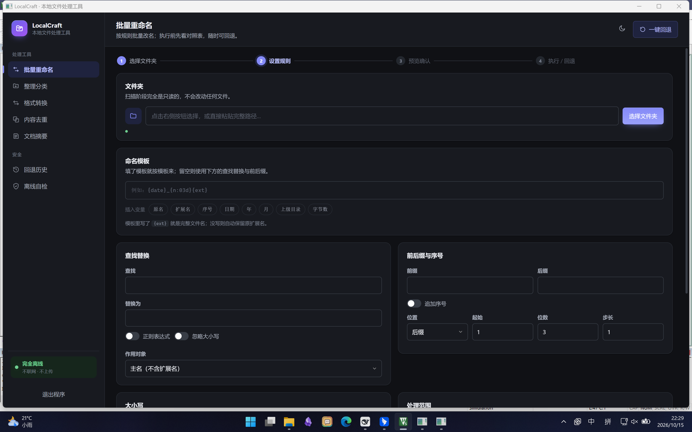

# LocalCraft

> **完全离线的本地文件处理工具** · 纯 C 实现 · 不联网 · 不上传 · 不使用任何 AI 模型

**批量重命名 · 整理分类 · 文本内容替换 · 格式转换 · 内容去重 · 文档摘要 · 导出 Markdown/Word/PDF · 按 EXIF/ID3 重命名 · 自定义分类 · 备份同步 · 文件夹监控 · 表格处理**

核心承诺只有一条：

> ### 任何批量操作都遵循「先预览 → 再执行 → 可随时回退」

预览阶段完全只读，把每个文件的「旧状态 → 新状态」列成对照表；你确认后才真正落地；
执行过程逐步写入回退日志 —— 执行到第 7 步断电，前 6 步依然能完整还原，且回退本身也可再回退。



---

## 目录

- [下载与运行](#下载与运行)
- [关于「Windows 已保护你的电脑」](#关于windows-已保护你的电脑)
- [功能总览](#功能总览)
- [能力边界（不夸大）](#能力边界不夸大)
- [可回退机制是怎么做的](#可回退机制是怎么做的)
- [界面是怎么做的](#界面是怎么做的)
- [从源码构建](#从源码构建)
- [测试与测试数据](#测试与测试数据)
- [项目结构](#项目结构)
- [为什么用 C](#为什么用-c)
- [不做的事](#不做的事)
- [开发约定](#开发约定)
- [许可](#许可)

---

## 下载与运行

到 [Releases](../../releases) 下载 `LocalCraft.zip`，解压后双击 **`LocalCraft.exe`**。

```
LocalCraft/
├── LocalCraft.exe          ← 双击这个
├── WebView2Loader.dll      ← 必须和 exe 放在一起，别单独拖走 exe
├── 解除锁定.bat            ← 如果弹安全提示，双击这个（见下一节）
└── 使用说明.txt
```

**不需要安装任何运行库。** 程序是静态链接的，目标电脑不需要 Python、.NET、VC++ 运行库。

界面由系统自带的 **Microsoft Edge WebView2 Runtime** 渲染（Windows 10/11 基本都自带）。
万一那台电脑没有，程序会**自动退回纯 Windows 控件界面**并说明原因，功能一样，不会白屏。

**U 盘便携**：在 exe 同目录放一个空的 `portable.marker` 文件，
日志、回收站、界面配置就都写在 exe 旁边的 `.localcraft\` 里，不碰系统盘。

命令行参数：

| 参数 | 用途 |
|------|------|
| （无） | 正常启动图形界面 |
| `--native` | 用纯 Win32 控件界面（不依赖 WebView2） |
| `--web` | 启动本地服务并用系统浏览器打开（调试用） |
| `--headless --port 8080` | 只启动本地服务，自己用浏览器打开（调试用） |
| `--version` | 显示版本 |

---

## 关于「Windows 已保护你的电脑」

第一次运行时 Windows 可能弹出这个提示。**这是对所有未签名程序的默认提示，不代表程序有问题。**

它出现有两个原因：

1. 程序没有购买代码签名证书；
2. 文件从网上下载、或经 QQ / 微信 / 网盘传送时，Windows 会给它打一个**「网络来源」标记**。

三种解决办法，任选一种：

| 方式 | 操作 | 效果 |
|------|------|------|
| **推荐** | 双击 `解除锁定.bat` | 去掉标记，之后不再弹 |
| 一次性 | 弹窗里点「更多信息」→「仍要运行」 | 只对这次有效 |
| 手动 | 右键 exe → 属性 → 勾选「解除锁定」 | 和第一种是同一件事 |

**务必先解压再运行。** 在压缩包里直接双击的话，Windows 会把标记一并传给解压出来的文件，弹窗照旧。

> 本项目不提供"关掉系统安全防护"的方案 —— 那会让你的电脑对所有程序都放松警惕。

---

## 功能总览

### 一、可回退的批量操作底座

| 功能 | 说明 |
|------|------|
| **批量重命名** | 模板变量、查找替换（含正则）、序号、前后缀、大小写转换 |
| **整理分类** | 按类型 / 年份 / 扩展名 / 首字母 / 体积分层，与重命名共用同一套引擎 |
| **文本内容替换** | 在文件的**内容**里批量查找替换，支持正则与捕获组 |
| **表格处理** | 读取 xlsx / csv，做筛选、排序、选列、合并，输出 CSV |
| **备份 / 同步** | 把文件夹同步到另一个位置，只增不删、已相同的文件不重复复制 |

这五个都建立在同一套「预览 → 执行 → 回退」骨架上。
它们的产物和动作全部进日志，随时可以一键还原。

### 二、内容理解与转换

| 功能 | 说明 |
|------|------|
| **格式转换** | 内置文本互转 + Office 抽取 + 图片互转；外部引擎可选接入 |
| **内容级去重** | 文档抽文本 + SimHash 指纹 + 分带 LSH 聚类，**按正文而不是文件名** |
| **文档摘要** | TextRank / TF-IDF，纯算法，不依赖任何 AI 模型 |
| **导出 Markdown / Word / PDF** | 中文排版已处理标题层级与东亚字体 |
| **文件夹扫描与分类** | 扫描阶段完全只读 |

### 三、按元数据工作

| 功能 | 说明 |
|------|------|
| **照片按拍摄时间重命名** | 读 EXIF：拍摄日期、相机厂商 / 型号、镜头、焦距、光圈、快门、ISO |
| **音乐按标签重命名** | 读 ID3：艺术家、标题、专辑、音轨号、年份、流派 |

`{date}` 取的是**文件修改时间**，而照片的修改时间常常不是拍摄那天 ——
拷来拷去、同步网盘、重新导出都会改掉它。**拍摄时间只能从 EXIF 里读**：

```
{exif:date:%Y%m%d}_{n:03d}      →  20260315_001.jpg
{exif:model}_{exif:iso}         →  Canon EOS R6_400.jpg
{id3:artist} - {id3:title}      →  周杰伦 - 夜曲.mp3
```

### 四、自动化与自定义

| 功能 | 说明 |
|------|------|
| **用户自定义分类** | 用 INI 配置文件定义自己的分类规则，程序按你的规则归类 |
| **文件夹实时监控** | 盯着一个文件夹，记录刚刚变化的文件 |

自定义分类支持三种匹配条件，满足任意一条即命中：

```ini
[发票]
ext   = pdf, ofd             ; 按扩展名
name  = 发票, 增值税, 报销    ; 文件名里含有这些词
order = 10                   ; 优先级，数字小的先试

[截图]
name_regex = (截图|screenshot)   ; 文件名匹配正则
order = 40
```

**配置文件首次运行会自动生成**，里面写好了格式和例子，照着改就行。
示例规则**默认全是注释状态** —— 装上之后默认行为和你没写任何配置时完全一致。

界面上的 **「离线自检」页**会如实列出哪些外部引擎已接入、哪些没有 —— 不会假装可用。

---

## 能力边界（不夸大）

| 能力 | 内置 | 需要外部组件 |
|------|:----:|--------------|
| txt / md / html / csv 互转 | ✅ | — |
| docx / xlsx / pptx / pdf **读取**抽文本 | ✅ | — |
| png / jpg / bmp / gif / tiff 图片互转 | ✅ | — |
| md → docx / pdf（导出器） | ✅ | — |
| docx / xlsx / pptx **写出** | 仅 Word | — |
| 读 EXIF（JPEG / TIFF / 各类相机 RAW） | ✅ | — |
| 读 ID3（v1 / v2.2 / v2.3 / v2.4） | ✅ | — |
| 读 xlsx 单元格结构（含**日期**换算） | ✅ | — |
| 写 xlsx | — | **不做**（只输出 CSV，见下） |
| docx ↔ pptx ↔ odt ↔ epub 互转 | — | Pandoc |
| 任意 Office ↔ PDF（保版式） | — | LibreOffice |
| 音视频转换 | — | FFmpeg |
| 相机 RAW **解码**成图片 | — | LibRaw（但 RAW 的 EXIF 能读） |
| 扫描件 OCR | — | **不做**（需要 AI 模型） |
| PDF 文字抽取 | 基础 | 使用 Identity-H CID 字体的 PDF 会**明确报"暂不支持"**，不会返回乱码 |

**绝大多数功能都有内置实现，不装任何外部组件也能用。** 外部引擎只是"更强"，不是"必需"。

### 几处刻意的能力限制

这三条不是没做，是**想清楚了不做**：

| 限制 | 原因 |
|------|------|
| **同步只增不删**（不叫"镜像"） | 真正的镜像工具会删掉目标里多余的文件。一次误操作把目标设成 `D:\`，镜像会清掉整个盘里"不该在"的文件且恢复不了。这个程序承诺**没有任何不可逆的删除** |
| **监控不会自动处理** | "监控到变化就自动处理"意味着你还没看过预览、文件就已经被动了。监控只负责**发现**，处理由你点一下再说 |
| **表格只输出 CSV** | 写 xlsx 要自己拼一套 OOXML（共享字符串表、样式、列宽），出错方式非常多，而收益只是"双击能直接打开"。CSV 通用性最好，产物再进 Excel 精修是正常流程 |

---

## 可回退机制是怎么做的

### 一切归约为 4 种原子步骤

| 步骤 | 作用 | 逆操作 |
|------|------|--------|
| `MOVE(src → dst)` | 移动 | `MOVE(dst → src)` |
| `COPY(src → dst)` | 复制 | `MOVE(dst → 回收站)` |
| `MKDIR(dst)` | 建目录 | `RMDIR(dst)`（非空则跳过，绝不递归删） |
| `RMDIR(dst)` | 删空目录 | `MKDIR(dst)` |
| `CREATE(dst)` | 生成文件 | `MOVE(dst → 回收站)` |

**没有"删除"这个动作。** 覆盖 = 旧文件先移进回收站，再放新的进去。所以任何一步都能反过来。

### 原地改文件内容是怎么回退的

文本替换是第一个**改文件内容**的模块，也是最难回退的一类操作。
如果只写一条 `CREATE`，回退就只会把改过的文件删掉，用户的原内容永远找不回来。

用的办法是拆成两条步骤，让逆序回退天然正确：

```
正向：  ① MOVE(原文件 → 回收站)      先留个底
        ② CREATE(原文件)              内容由生成器写进去

回退：  ②' 删掉改过的版本
        ①' 把回收站里的原件搬回来
```

**回退引擎一行都没改**，但文件内容能还原到**字节级完全一致**
（测试里用 `memcmp` 和 SHA-256 都验证过）。

### 日志格式（JSONL，追加写，每步 fsync）

```
{"t":"header","plan":"20261016-182600-1a7d3d8f","n":3,...}
{"t":"action_begin","i":0,"kind":"edit","src":"D:\\a.txt","dst":"D:\\a.txt"}
{"t":"step","i":0,"seq":0,"kind":"move","src":"D:\\a.txt","dst":"...\\0001__a.txt"}
{"t":"step","i":0,"seq":1,"kind":"create","dst":"D:\\a.txt","size":157}
{"t":"action_end","i":0,"status":"done"}
{"t":"footer","status":"completed","ok":3,"failed":0,"skipped":0}
```

每写一步就 `WriteFile` + `FlushFileBuffers`。断电时日志里只有**真正发生过**的事，
回退就是"把成功步骤倒过来取逆操作"。

### 回退的安全边界

- 回退**不会覆盖**：如果原位置已被别的文件占用，跳过并明确告诉你
- 回退**本身也写日志**，所以回退可以再被回退（即"重做"）
- 目录非空时**不递归删**，只提示

### 冲突分析顺序（顺序本身有讲究）

```
静态校验 → 链式移动检测 → 策略解析 → 重复目标 → 步骤拆解
```

链式移动（A→B、B→C 同时出现）必须在策略解析**之前**检测 ——
否则"重命名"策略会把真正的冲突掩盖成看起来正常的目标。

---

## 界面是怎么做的

界面是 HTML / CSS / JS，但**不是网页**：整套资源打包进 exe，
由一个只监听 `127.0.0.1` 的本地服务通过 **WebView2** 呈现，没有任何出站连接。

| 做法 | 原因 |
|------|------|
| 不用系统浏览器 | 双击 exe 就出窗口，不需要用户手动开浏览器 |
| 不用 Electron | 150 MB 起步，和"1 MB 出头"的目标冲突 |
| 界面资源嵌入 exe | 单文件分发，不会出现"少了 css 文件导致界面错乱" |

### 安全性

- 服务只绑定 `127.0.0.1`，不监听外部网卡
- 每次启动生成 32 字符随机 token，所有 `/api/*` 请求都要带 token
- 校验 `Origin` 头
- **不发起任何出站连接**

### 无障碍

- **支持系统的「降低动效」偏好**：开启后所有过渡和动画时长压到 0.001 毫秒，
  并取消全部空间位移与缩放（不是"调快"，是关掉 —— 位移本身才是引起不适的东西）
- **键盘焦点可见**：按钮、导航、输入框都有清晰的焦点环。
  用 `:focus-visible` 而不是 `:focus`，鼠标点击不会显示
- **预览表支持键盘勾选**：勾选框是 `<div>` 不是原生 checkbox，
  所以用 roving tabindex 自己实现了键盘导航（方向键移动、空格/回车切换）

降低动效**不会**把焦点环一起去掉 —— 有人因为动画眩晕，不代表不需要看见焦点在哪。

---

## 从源码构建

只需要 **MinGW-w64 gcc** —— 不需要 MSVC、CMake、Python、Node。

```powershell
# 编译
powershell -ExecutionPolicy Bypass -File build\build.ps1

# 编译并跑全部测试
powershell -ExecutionPolicy Bypass -File build\build.ps1 -Tests

# 从零重建
powershell -ExecutionPolicy Bypass -File build\build.ps1 -Clean
```

产物：`build\LocalCraft.exe`

`gcc` 不在 PATH 时，脚本会自动尝试 `C:\mingw64\bin`、`C:\msys64\mingw64\bin` 等常见位置。

---

## 测试与测试数据

```powershell
powershell -ExecutionPolicy Bypass -File build\build.ps1 -Tests
```

**1127 条断言**，12 个测试文件：

| 测试 | 条数 | 覆盖 |
|------|:----:|------|
| `test_core` | 92 | 计划、冲突分析、执行、回退的往返 |
| `test_server` | 85 | API 层：JSON 编解码、会话、各项操作的端到端 |
| `test_json` | 247 | JSON 读写器 |
| `test_regex` | 230 | 手写正则引擎（MinGW 没有 `regex.h`） |
| `test_zip` | 83 | CRC-32、RFC 1951 inflate、ZIP 读写 |
| `test_analysis` | 50 | 分词、SimHash、摘要、去重 |
| `test_export` | 87 | Markdown / docx / PDF 导出、图片与文本转换 |
| `test_findrep` | 49 | 文本替换：编码识别、二进制防护、生成器规格、字节级回退 |
| `test_category` | 45 | 自定义分类：规则解析、优先级、出错容错、编码 |
| `test_meta` | 57 | EXIF / ID3：大小端、畸形文件、ID3v1/v2 |
| `test_backup` | 52 | 备份同步：安全检查、差异判断、严格比对、只增不删 |
| `test_table` | 50 | 表格：xlsx 解析、日期基准、CSV 转义、筛选排序 |

### 测试造数据的方式

有几类测试的数据是**特意用真实工具造**的，因为手拼的假数据发现不了真问题：

| 数据 | 用什么造 | 为什么 |
|------|----------|--------|
| EXIF | Pillow | 真实相机的字段布局；大小端两种字节序 |
| xlsx | openpyxl | **它会显式写 `t="n"`，而 Excel 省略** —— 这个差异只有拿真文件才暴露得出来 |
| ID3 | 手工构造字节 | 覆盖 v1 和 v2.2/2.3/2.4 各版本 |
| 动画 | Edge 无头模式读计算样式 | 静态截图证明不了"动画真的被关掉了" |

`test_table` 里的 xlsx 则是**用 zip 写出器在内存里现造**的 —— 测试自包含，
不依赖 Python，但走的是和真实文件完全一样的解析路径。

### 测试数据

```powershell
python tools\make_testdata.py      # 六组基础素材
python tools\make_media.py   OUT   # 带真实 EXIF / ID3 的媒体文件
python tools\make_tables.py  OUT   # 带真实日期格式的 xlsx
```

`make_testdata.py` 生成的素材按功能分成六组：

| 目录 | 文件数 | 用来测什么 |
|------|:------:|-----------|
| `01-重命名素材` | 13 | 文件名含空格、括号、大小写中英文混杂 |
| `02-待整理` | 11 | 各种类型混放 + 两层子文件夹 + 压缩包 |
| `03-重复内容` | 7 | 正文高度相似但文件名不同 |
| `04-摘要素材` | 4 | 1200 字上下的中文长文 |
| `05-格式转换` | 7 | 同一张图存成四种格式 |
| `06-Office文档` | 4 | docx / xlsx / pptx / pdf |

**这份数据不是摆设** —— 写它的当天就跑出了一个真 bug：选「转成 PNG」时，
同一文件夹里的 `.txt` 也被列进预览表并标成"正常可执行"。
根因是 `api.c` 里判断算出来了却丢在空花括号里。详见 `src/convert.c` 中
`convert_feasibility()` 的注释 —— 那里也记录了修复时踩的第二层坑。

---

## 项目结构

```
LocalCraft/
├── src/                    纯 C 源码（31 个文件）
│   ├── lc.h                唯一的共享头文件
│   ├── util.c              内存池、字符串、UTF-16↔UTF-8、路径
│   ├── planner.c           计划与冲突分析        ┐
│   ├── journal.c           JSONL 日志            │ 可回退底座
│   ├── executor.c          执行                  │
│   ├── rollback.c          逆序还原              ┘
│   ├── rename.c            重命名规则与模板引擎
│   ├── organize.c          分类规则
│   ├── findrep.c           文本内容批量查找替换
│   ├── category.c          用户自定义分类（INI 解析）
│   ├── meta.c              EXIF / ID3 解析
│   ├── backup.c            备份 / 同步（含 SHA-256 校验）
│   ├── watch.c             文件夹实时监控
│   ├── table.c             表格读取 / 筛选 / 排序 / 合并 / CSV
│   ├── convert.c           格式转换（GDI+ 图片 + 文本）
│   ├── extract.c           文档抽文本（docx/xlsx/pptx/pdf/html）
│   ├── text.c              中文二元分词、断句、编码探测
│   ├── dedup.c             SimHash + 分带 LSH + 并查集
│   ├── summarize.c         TextRank / TF-IDF
│   ├── export.c            Markdown / docx / PDF 写入
│   ├── zip.c               CRC-32、inflate、ZIP 读写
│   ├── json.c              JSON 读写器
│   ├── regex.c             手写回溯正则引擎
│   ├── api.c               API 层（约 50 个方法）
│   ├── webview.c           WebView2 宿主 + 请求拦截
│   ├── webview2.h          手写的 WebView2 COM 接口声明
│   ├── app.rc              图标 + 版本信息 + 清单
│   └── app.manifest        控件主题 + DPI 感知 + asInvoker
├── webui/                  HTML / CSS / JS 界面
├── tests/                  12 个测试文件，1127 条断言
├── tools/
│   ├── embed.c             把界面打包成 C 数组
│   ├── make_icon.py        生成应用图标
│   ├── make_testdata.py    生成基础测试数据
│   ├── make_media.py       生成带 EXIF / ID3 的媒体文件
│   └── make_tables.py      生成带真实日期格式的 xlsx
├── docs/                   架构文档、截图、界面样式校验页
├── third_party/            WebView2 官方头文件与加载器
├── build/build.ps1         构建脚本
├── 打包版本.ps1            归档一个版本（源码包 + 程序包 + 文档快照）
├── 记录更新.ps1            写 CHANGELOG
└── 上传到GitHub.ps1        推送到 GitHub（带安全检查）
```

---

## 为什么用 C

|  | 本实现 | Python + Nuitka | Electron |
|---|:---:|:---:|:---:|
| 发布体积 | **1.2 MB** | 25–100 MB | 150 MB+ |
| 需要运行库 | **不需要** | 不需要 | 不需要 |
| 内存占用 | **约 10 MB** | 60–120 MB | 200 MB+ |
| 启动时间 | **< 0.2 s** | 1–3 s | 1–3 s |
| 界面观感 | 现代 Web UI | 取决于 GUI 框架 | 现代 Web UI |

体积和内存是硬指标（"U 盘即插即用""4GB 内存流畅运行"）。
纯 C + 静态链接把体积压到 1 MB 出头，同时用内嵌 Web UI 拿到现代界面观感。

**没有第三方库** —— 文件解析、正则、ZIP、JSON、分词、摘要算法、
EXIF / ID3 / xlsx 解析全部自己实现，所以 exe 里塞得下一整套中文文档处理能力，
而不用背一个运行时的包袱。

### 技术要点

- **内存**：每个任务一个 arena（内存池），整个计划的所有字符串归它管，一次性释放
- **正则**：MinGW-w64 不提供 `regex.h`，所以手写了一个带回溯步数上限的引擎
- **ZIP**：docx / xlsx / pptx 本质是 zip 包，自研了 CRC-32 与 RFC 1951 inflate
- **分词**：中文用**相邻二元组**（"本地文件" → 本地/地文/文件），不依赖词典
- **PDF**：用 `STSong-Light` + `UniGB-UCS2-H` 直接写中文，不需要嵌入字体
- **docx**：用 `Heading1`…`Heading6` + `w:outlineLvl` 保证导航窗格认得出层级，
  每个 run 显式写 `w:rFonts` 的 `ascii`/`hAnsi`/`eastAsia` 三个字体
- **EXIF**：字节序由 TIFF 头前两字节决定（II / MM），不是固定小端；
  值有内联和偏移两种存法，偏移一律做边界检查
- **xlsx 日期**：xlsx 里日期根本不存在 —— 它是"一个数字 + 一个样式"，
  单元格存的是 `46027`，靠样式告诉 Excel 显示成 `2026-01-05`。
  所以读的时候必须先去解析 `xl/styles.xml`，否则所有日期都是天书
- **监控**：`ReadDirectoryChangesW` + 重叠 I/O；按**具体路径**抑制自己触发的变更，
  而不是"静默 N 秒"（静默期间用户真改了别的文件会漏掉）

---

## 不做的事

为了不夸大能力，这里明确列出：

| 不做 | 原因 |
|------|------|
| 扫描件 OCR | 需要 AI 模型，与「不使用任何 AI 模型」直接冲突 |
| 联网 / 上传 / 遥测 | 程序不发起任何出站连接 |
| 图片转文字 | 同上，属于识别类工作 |
| 关闭系统安全防护 | 那会让整台电脑对所有程序放松警惕 |
| 不可逆的删除 | 与「可回退」承诺冲突，见上文「几处刻意的能力限制」 |
| 监控到就自动处理 | 同上 |
| 写 xlsx | 见上文说明 |

---

## 开发约定

### 每次改动都要写日志

所有重要改动记录在 [CHANGELOG.md](CHANGELOG.md)。这不是可选项 —— 上传脚本会检查：
如果这次动了代码但 `[未发布]` 区块还是空的，`上传到GitHub.ps1` 会停下来提醒你补一条。

手工写太麻烦，用附带的脚本：

```powershell
.\记录更新.ps1 -Added "支持拖拽文件夹" -Fixed "修正 200% 缩放下窗口跑出屏幕"

# 不带参数就是交互模式，逐个分类问
.\记录更新.ps1

# 发版本：把 [未发布] 收口成版本号，并重新开一个空的 [未发布]
.\记录更新.ps1 -Release 2.2.0
```

### 归档与上传

```powershell
# 归档一个版本：源码包 + 程序包 + 文档快照 + SHA256 清单 → 发布\vX.Y.Z\
.\打包版本.ps1

# 推送到 GitHub
.\上传到GitHub.ps1 -DryRun              # 先看会做什么
.\上传到GitHub.ps1                      # 推代码
.\上传到GitHub.ps1 -Tag v2.1.0          # 推代码 + 打版本 tag
```

仓库里同时放三类东西，性质完全不同：

| 类别 | 内容 | 去哪 |
|------|------|------|
| **源码** | `src/` `tests/` `tools/` `webui/` `third_party/` | 推分支（别人 clone 下来编译） |
| **软件** | `dist/` 里的 exe 和 dll | 推分支 + **挂到 Releases 附件** |
| **介绍** | `README.md` `教程.md` `CHANGELOG.md` `docs/` | 推分支 |

`上传到GitHub.ps1` 会在提交前做两件检查：

1. **分类清点** —— 把即将上传的东西按上面三类列出来。混在一起很容易出事，
   比如软件忘了重新构建，就会出现"README 说 2.1.0、下载的却是 2.0.0"。
2. **版本一致性** —— 比对 `src/app.rc` 里的版本号和 `dist/LocalCraft.exe` 的实际版本号，
   不一致就停下来（确认要以现状上传可以加 `-Force`）。

它还做一件更要紧的事：**暂存前强制核对仓库根目录**（`git rev-parse --show-toplevel`）。
git 找仓库是"从当前目录逐级向上找 `.git`"，如果目标目录自己没有 `.git`，
它会一路认到用户主目录 —— 而很多工具会在那里建一个 `.git`。
一旦认错，`git add -A` 会把整个主目录（含 `.bash_history`、SSH 密钥、浏览器数据）
加进来，推到公开仓库就永久留在提交历史里了。

### 发一个正式版本

```powershell
.\打包版本.ps1                          # 1. 归档
.\上传到GitHub.ps1 -Tag v2.1.0          # 2. 推代码 + 打 tag
```

然后到 [Releases 页面](https://github.com/Sudfry/LocalCraft/releases/new)：
标题填 `LocalCraft v2.1.0`，正文从 `CHANGELOG.md` 里对应那一段粘过去，
把 `发布\v2.1.0.zip` 拖进附件区，点 Publish release。

**附件不能忘。** 没有附件的话，别人只能拿源码自己编译 ——
而这个项目的卖点之一恰恰是"解压双击就能用"。
打包脚本会自动把附件准备好，剩下那两下点击得你自己来（上传附件需要令牌，
不在脚本里存凭据）。

---

## 许可

MIT，见 [LICENSE](LICENSE)。
